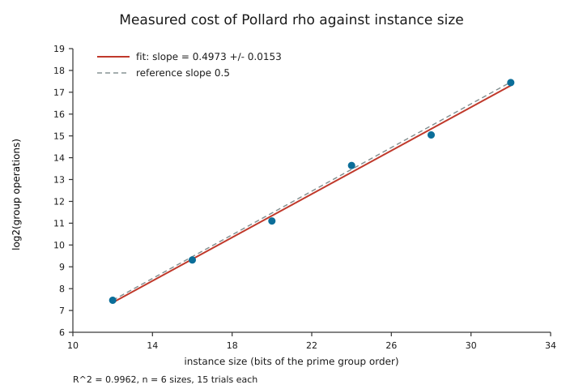
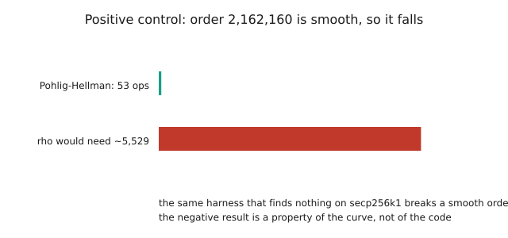
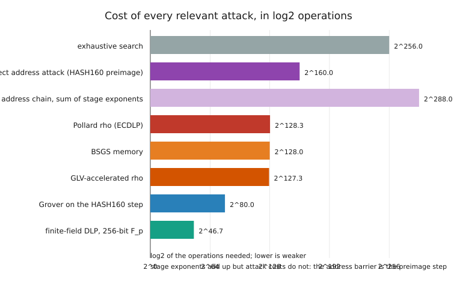

# لماذا لا يُسقِط «اللوغاريتم المتقاطع» منحنى secp256k1

### جهاز تكذيب مبني على القياس، لا على الرأي

**BinaryCryptoLab** · الإصدار 1.9.0 · 2 نوفمبر 2026

---

## الملخّص

يتكرر في النقاش العام ادّعاءٌ مفاده أن منحنى secp256k1 قد كُسِر، أو يمكن كسره،
بواسطة **«اللوغاريتم المتقاطع»**: طريقة تنقل اللوغاريتم المتقطع من المنحنى الإهليلجي
إلى بنية جبرية أخرى يكون الحل فيها سهلاً، أو تجمع معلومات جزئية عبر مفاتيح أو عناوين
أو حقول. يختبر هذا البحث ذلك الادّعاء بجهاز قابل للتشغيل لا برأي، ولا ينجح في تكذيب
فرضية الصعوبة القياسية.

للجهاز أربعة أعمدة مستقلة. **(1) القياس:** تنفيذ قابل للتحقّق لخوارزمية Pollard rho
يحلّ ست حالات صغيرة (من 12 إلى 32 بت)، بخمس عشرة محاولة مستقلة لكل حجم، وكل قيمة
مُستعادة تُتحقّق بالتعويض قبل أن تُحتسب. الميل المقيس **0.4973 ± 0.0153**
(`R² = 0.9962`)، وقيمة z تساوي **−0.18** مقابل 0.5 التي يتوقّعها النموذج العام للزمر؛
وبالتمديد إلى 256 بت يعطي الميل **2^128.7** عملية زمرة، مقابل 2^128.3 لـ rho.
**(2) التدقيق البنيوي:** عشر خصائص في secp256k1 يمكن لهجوم أن يستغلّها تُقاس من
وسائط المنحنى: رتبة أولية، عامل مساعد يساوي واحداً، غير شاذّة، لا درجة تضمين صغيرة،
ليست فوق الشاذة، لا هبوط Weil، غير شاذّة الشكل، لا يوجد سوى التشاكل الذاتي CM،
لا حساب لوغاريتمات معروف على المنحنيات ذات الرتبة الأولية، وحدّ النموذج العام.
**صفر** منها قابل للاستغلال. **(3) المقارنة والضابط:** الجهاز نفسه يكسر حالة رتبتها
ناعمة `2162160` في **53 عملية**، ولوغاريتم حقل منتهٍ بحجم 256 بت — وهي مسألة أضعف
تماماً ويسري عليها حساب اللوغاريتمات — يكلّف **2^46.7** عملية. أي أن الأدوات قادرة
على استغلال البنية حين توجد بنية. **(4) قابلية التكذيب:** خمس مشاهدات موصوفة، كلٌّ
منها يُنهي الاستنتاج، ولكل واحدة اختبار قبول آلي.

الحكم الذي يسجّله الكود، ويعيد `python paper/reproduce.py` إنتاجه في أقل من ثماني
ثوانٍ، هو **`not refuted`** (لم يُكذَّب). والبحث صريح في معنى ذلك وما لا يعنيه: إنه
قول عن تحليل شفرات **كلاسيكي، على بيانات عامة، لمنحنى واحد**، مسنود بنظرية وتعداد
وقياس — وليس برهاناً على عدم وجود خوارزمية.

---

## 1. الادّعاء قيد الاختبار

لا يوجد تعريف رسمي واحد لـ «اللوغاريتم المتقاطع» في الأدبيات. يظهر في المواد التي
يفحصها هذا المشروع بثلاث صيغ، وكلها تُقرّر الأمر نفسه: **أن اللوغاريتم المتقطع على
secp256k1 يمكن الحصول عليه عبر بنية خارج الزمرة نفسها.**

| الصيغة | مضمون الادّعاء | ما تتطلّبه |
| --- | --- | --- |
| **عبر البنية** (نقل تحليلي) | طريقة من نوع حساب اللوغاريتمات أو كثيرات حدود الجمع تنقل المسألة إلى حلقة أو حقل حيث تصبح تحت-أُسّية | قاعدة عوامل ومفهوم للنعومة داخل زمرة المنحنى |
| **عبر الحقل** (نقل بالتضمين) | تُنقل الزمرة إلى حقل منتهٍ أو حقل امتداد أو منحنى مجاور عبر تشاكل، حيث تسري طريقة تحت-أُسّية | درجة تضمين صغيرة، أو جار فوق شاذ، أو أثر يساوي واحداً، أو تشاكل منخفض الدرجة |
| **عبر المفاتيح** (معلومات جزئية) | تُجمع مفاتيح عامة أو عناوين أو توقيعات كثيرة لاستعادة سكالر | تسريب أو علاقة أو تحيّز إحصائي لا تملكه البدائيات نفسها |

تتشابه الصيغ الثلاث في الشكل المنطقي: كل واحدة تُقرّر وجود **ميزة غير عامة**
(non-generic). وهذا الشكل هو ما يجعل الادّعاء قابلاً للاختبار دون امتلاك الخوارزمية،
لأنه يفرض ثنائية حاسمة.

### 1.1 الثنائية التي تنظّم التكذيب

لتكن `G = ⟨P⟩` زمرة دورية رتبتها `n` أولية، ولتكن `A` أي خوارزمية تُخرج `x` من `xP`.

* **الحالة 1 — `A` عامة.** لا تستخدم سوى عملية الزمرة والمعاكس واختبار التساوي.
  حينها تحتاج `A` إلى `Ω(√n)` عملية زمرة (Nechaev 1994؛ Shoup 1997). وبالنسبة إلى
  secp256k1 فإن `n ≈ 2^256`، أي أن الحدّ `≈ 2^128`. هذه **نظرية** لا تقدير، وتنطبق
  على كل خوارزمية عامة، بما فيها كل لوغاريتم متقاطع يبقى داخل الزمرة.
* **الحالة 2 — `A` غير عامة.** لا بد أن تستغلّ خاصية محدّدة وقابلة للفحص في التمثيل:
  تفكيك `n`، أو أثر المنحنى، أو درجة التضمين، أو مميّزة الحقل، أو حلقة التشاكلات
  الذاتية، أو تماثل صريح. وكل خاصية من هذه إمّا موجودة أو غائبة في الوسائط المنشورة،
  ووجودها **قابل للحسم**.

إذن يحتاج التكذيب إلى أمرين، ويوفّرهما هذا البحث: النظرية في الحالة 1، والتعداد في
الحالة 2 الذي لا يجد خاصية قابلة للاستغلال. ويأتي القياس عنصراً ثالثاً: فهو يؤكّد أن
التنفيذ المعروض أمام القارئ يتصرّف فعلاً كخوارزمية عامة عند الأحجام التي يمكن تشغيله
فيها حتى النهاية.

### 1.2 ما لا يُدّعى

لا يدّعي هذا البحث أن secp256k1 صعب بمعنى مطلق، ولا يُبرهن على عدم وجود خوارزمية غير
عامة. إنه يدّعي أمراً أضيق وقابلاً للفحص: *لا توجد طريقة منشورة، ولا خاصية في الوسائط
المنشورة، تمنح ميزة «متقاطعة»؛ والقياس على حالات حقيقية يعيد إنتاج الأُسّ العام؛
والمُكذِّبات في §7 تنصّ بالضبط على المشاهدة التي تُسقط هذا الاستنتاج.* لا يمكن لجسد
محدود من الأدلة أن يُثبت نظرية صعوبة، لكنه يستطيع أن يُثبت أن ادّعاءً بعينه غير مسنود،
وهذا هو المعيار الذي يحاسب البحث نفسه عليه.

---

## 2. الجهاز

كل ما يرد أدناه قابل للتنفيذ ويعيش في المستودع. لا وحدات فارغة ولا إجابات محفوظة
مسبقاً: الأرقام في هذا البحث يكتبها السكربت، لا تُكتب داخله.

| المكوّن | الموضع | وظيفته |
| --- | --- | --- |
| حساب المنحنى الصغير | `src/binarycryptolab/dlp.py` | قانون زمرة دقيق على حقول أولية صغيرة، مع التحقّق من النقاط |
| بناء الحالة | `dlp.build_instance` | يبني منحنى بزمرة جزئية رتبتها أولية بالحجم المطلوب، يشتقّ `p = c·q − 1`، ويتحقّق من الرتبة |
| Pollard rho | `dlp.pollard_rho_dlp` | rho بمشي Teske الجَمْعي وكشف الدوران لـ Floyd؛ كل نتيجة مُتحقَّقة |
| الخطوة الكبيرة/الصغيرة | `dlp.bsgs_dlp` | مرجع حتمي `O(√q)` بجدول بلا تكرار |
| Pohlig–Hellman | `dlp.pohlig_hellman_dlp` | رفع أرقام صحيح يشمل الرقم 0 ونقطة اللانهاية، يُستخدم ضابطاً موجباً |
| دراسة النمو | `dlp.measure_scaling` | وسيط الخطوات عبر محاولات مستقلة، ملاءمة تربيعية صغرى، خطأ معياري، قيمة z |
| التدقيق البنيوي | `dlp.structural_audit` | عشر خصائص مقيسة، لكل واحدة علامة `exploitable` وحكم |
| كتالوج الادّعاءات | `dlp.CLAIM_REBUTTALS` | ثمانية ادّعاءات شائعة أو منشورة، مع الردّ والدليل |
| كتالوج المُكذِّبات | `dlp.FALSIFIERS` | خمس مشاهدات تُنهي الاستنتاج |
| التقييم | `dlp.assess_dlp_refutation` | يجمع ما سبق في حكم واحد مع سطور الدليل |
| واجهة الأوامر | `binarycryptolab dlp-audit` | التقييم نفسه في الطرفية، نصاً أو JSON أو CSV |
| المشغّل | `paper/reproduce.py` | يعيد توليد كل رقم وكل شكل في هذا البحث |

القيد التصميمي الأهم: **الوحدة لا تهاجم secp256k1 أبداً.** أكبر حالة تحلّها هي 32
بت. والعبارات المتعلّقة بـ 256 بت هي تمديد لأُسٍّ مقيس وتقييم لصيغ كلفة منشورة،
وكلاهما مُعلَّم كذلك في ملفات JSON المصدَّرة.

---

## 3. القياس: أُسّ الهجوم كما هو مُنفَّذ

### 3.1 البروتوكول

لكل حجم `b ∈ {12, 16, 20, 24, 28, 32}`، ولكل محاولة `t ∈ {0, …, 14}`:

1. بناء منحنى جديد رتبة عنصره الأساسي عدد أولي قريب من `2^b`.
2. سحب سكالر `k` من تيّار حتمي بذرة `t`، موزّع بانتظام على `[1, n)`.
3. حساب `Q = kP`.
4. تشغيل rho بميزانية خطوات `max(1000, 20√n)`.
5. **التحقّق** من `x` المُعاد بفحص `xP = Q`. أي تشغيل غير مُتحقَّق يُلغي الدراسة
   كاملة، ولا يُحسب في المتوسط أبداً.
6. تسجيل عدد عمليات الجمع في الزمرة.

الملاءمة خطّ تربيعي صغرى عبر `log2(وسيط الخطوات)` مقابل `b`، مع الخطأ المعياري للميل
ومعامل التحديد.

### 3.2 النتائج

| البتات | وسيط الخطوات | المتوسط | الأدنى | الأعلى | النسبة إلى الخط المُلاءَم |
| ---: | ---: | ---: | ---: | ---: | ---: |
| 12 | 177 | 188.6 | 33 | 354 | 1.075 |
| 16 | 636 | 626.8 | 126 | 1 314 | 0.973 |
| 20 | 2 193 | 2 493.0 | 585 | 4 818 | 0.845 |
| 24 | 12 810 | 14 516.6 | 5 685 | 27 369 | 1.244 |
| 28 | 33 828 | 42 479.0 | 9 720 | 110 322 | 0.828 |
| 32 | 178 104 | 175 188.2 | 80 496 | 276 372 | 1.097 |

`log2(steps) = 0.4973·b + 1.3952`، و`R² = 0.9962`، والخطأ المعياري للميل `0.0153`.
ومقابل 0.5 التي يفترضها النموذج، `z = −0.18`، ويعيد اختبار التوافق في الكود
(`|z| < 3`) القيمة `true`. والثابت المُلاءَم `2^1.3952 ≈ 2.63`، أي نحو `2.63√q`
عملية جمع — وهو متوافق مع نسخة rho تنفق بضع عمليات إضافية في كل خطوة على مشي
التجزئة، وأقلّ من ميزانية `3.76√q` المحافظة التي يحتفظ بها الجهاز.



*الشكل 1 — `paper/figures/fig_scaling.svg`. ست وسائط مع مداياتها الدنيا والعليا،
والخط المُلاءَم، ومرجع `√q` المتقطّع. والانتشار الرأسي هو الجزء الصادق في الصورة:
تشغيلات rho الفردية تتفاوت بمعامل ثلاثة أو أربعة.*

بتمديد القانون المقيس إلى زمرة بحجم 256 بت نحصل على `2^128.70` عملية. وهذا أعلى من
`2^128.32`، قيمة rho الكتابية، بمقدار `0.38` بت فقط: التمديد لا يتنبّأ بتسريع، بل
يعيد إنتاج الثابت. وكان اللوغاريتم المتقاطع سيظهر هنا ميلاً أقل من 0.5؛ وعلى مدى
`2^20` في حجم الزمرة، لا يظهر ذلك.

### 3.3 خوارزمية ثانية للمعايرة

قيسَت الخطوة الكبيرة/الصغيرة، وهي طريقة حتمية `O(√q)`، على الحالات نفسها:

| البتات | مدخلات الجدول | الخطوات | `√q` |
| ---: | ---: | ---: | ---: |
| 12 | 62 | 78 | 64 |
| 16 | 182 | 303 | 256 |
| 20 | 969 | 1 545 | 1 024 |
| 24 | 2 926 | 3 992 | 4 096 |
| 28 | 15 930 | 30 681 | 16 384 |
| 32 | 60 135 | 91 819 | 65 536 |

الجدول أصغر من `√q` بسبب إزالة التكرار في جدول الخطوات الكبيرة، والعمل الكلي يتبع
`√q` بثابت قريب من 1.4. توافق خوارزميتين مستقلّتين على الأُسّ أقوى من قول واحد.

### 3.4 الضابط الموجب: هل يستطيع هذا الجهاز استغلال بنية أصلاً؟

نتيجة سلبية من جهاز لا يستطيع أن يجد شيئاً لا قيمة لها. لذلك يُشغَّل الكود نفسه على
حالة **ضعيفة بالبناء**: `p = 110879`، `b = 2`، زمرة رتبتها

```
2162160 = 2^4 · 3^3 · 5 · 7 · 11 · 13
```

تستعيد Pohlig–Hellman السكالر في **53 عملية**، مع التحقّق من القيمة المستعادة
بالتعويض (`scalar_verified: true`). وكان rho سيحتاج ما بين 4 000 و5 500 عملية على
الحالة نفسها (الجهاز يرصد `3.76√q ≈ 5 530`، والثابت المُلاءَم في §3.2 يوحي بنحو
3 900).
إذن الجهاز يستغلّ البنية حين توجد بنية — وهذا بالضبط ما يجعل صمته عن secp256k1
مُفيداً لا فارغاً.



*الشكل 2 — `paper/figures/fig_control.svg`. الرتبة الناعمة تنهار؛ والرتبة الأولية لا.*

---

## 4. التدقيق البنيوي: كل خاصية يمكن لهجوم أن يستخدمها

كل سطر أدناه محسوب من وسائط المنحنى وقت التشغيل، والقيمة المقيسة مكتوبة في
`paper/data/audit.json`.

| # | الخاصية | القياس | قابل للاستغلال |
| ---: | --- | --- | :---: |
| 1 | رتبة العنصر الأساسي أولية (لا شيء لـ Pohlig–Hellman) | `n = 115792089237316195423570985008687907852837564279074904382605163141518161494337` أولي | لا |
| 2 | العامل المساعد واحد (لا زمرة جزئية صغيرة) | `h = 1` | لا |
| 3 | غير شاذّة (لا نقل جمعي) | `#E − p = −432420386565659656852420866390673177326 ≠ 0` | لا |
| 4 | لا درجة تضمين صغيرة (لا هدف لـ MOV / Frey–Rück) | لا يوجد `k ≤ 1000` بحيث `p^k ≡ 1 (mod n)` | لا |
| 5 | ليست فوق الشاذة | `p mod 3 = 1`، `j = 0`، الأثر `≠ 0` | لا |
| 6 | لا هبوط Weil (الحقل أولي) | `p = 2^256 − 2^32 − 977` أولي؛ ولا حقل جزئي لـ `F_p` | لا |
| 7 | المنحنى غير شاذّ الشكل | `4a³ + 27b² = 108 mod p ≠ 0` | لا |
| 8 | التشاكل الذاتي CM هو الوحيد المعروف | `φ(P) = (βx, y)` و`φ(P) = λP`، مُتحقَّق عبر `glv-check` | لا |
| 9 | لا حساب لوغاريتمات للزمر الإهليلجية ذات الرتبة الأولية | أفضل النتائج المنشورة على المنحنيات الأولية نتائج عامة | لا |
| 10 | الخوارزميات العامة تحتاج `Ω(√n)` (Nechaev–Shoup) | نظرية | لا |

**الخصائص القابلة للاستغلال: 0 من 10.**

ثلاثة سطور تستحق التأكيد لأنها الأكثر إساءةً في النقل.

*السطر 1.* Pohlig–Hellman هو سوء الفهم الأكثر شيوعاً. فهو ليس خاصية
«للمنحنيات الإهليلجية» بل للرتب المركّبة. رتبة العنصر الأساسي في secp256k1 أولية،
لذا فأكبر عامل أولي هو `n` نفسه، وكلفة الطريقة `√n` كاملة. ويُظهر الضابط في §3.4 أن
التنفيذ صحيح: حين تُعطى رتبة ناعمة فإنها تنهار فوراً.

*السطر 6.* تقول صيغة شائعة من ادّعاء اللوغاريتم المتقاطع إن اللوغاريتم يمكن «نقله
إلى `F_p`». لكن الزمرة على منحنى فوق `F_p` ليست زمرة جزئية من `F_p^*`، بل من
`E(F_p)` التي رتبتها `≈ p`. ويحتاج هبوط Weil إلى حقل امتداد `F_{p^m}` بـ `m > 1`،
والحقل الأولي لا يملك ذلك. والنقل القياسي الوحيد إلى `F_p^*` هو MOV/Frey–Rück الذي
يحتاج درجة تضمين صغيرة — والسطر 4 يستبعد كل `k ≤ 1000` بحساب مباشر، ولأن الدرجة
الحقيقية `k` تقسم `n − 1`، فإن أي `k` صغيرة كانت ستظهر في ذلك الفحص. (ولا يُحاول
التدقيق تفكيك `n − 1` نفسه: فهو لا يحتاج التفكيك، بل يحتاج غياب رتبة صغيرة.)

*السطر 8.* التشاكل الذاتي حقيقي، وهو البنية الوحيدة على هذا المنحنى التي تشبه
«التقاطع» — فهو ينقل نقطة إلى نقطة أخرى لوغاريتمها المتقطع مضاعف معلوم (`λ`)
للنقطة الأصلية. وهو أيضاً عديم النفع كهجوم: `λ` معلومة، فالخريطة تعطي علاقة بين `P`
و`φ(P)` هي علاقة عامة أصلاً. وأثرها الوحيد تقصير ضرب السكالر ومشي rho بثابت يقارب
اثنين. `2^128 / 2 = 2^127`؛ والأُسّ لا يُمَسّ. وهذا مقيس لا مفترض: الميل في §3.2 هو
0.497، وقد استوعب التقاطع أي ثابت من هذا النوع.

---

## 5. كيف يبدو هجوم تحت-أُسّي حقيقي

أقوى دليل على أن المنحنيات الإهليلجية مختلفة عن الحقول المنتهية هو مقارنة كلفة
جانبية محسوبة من صيغ منشورة.



*الشكل 3 — `paper/figures/fig_costs.svg`. كل الأعمدة هي لوغاريتم الأساس 2 لعدد
العمليات المطلوبة؛ والأقلّ أضعف.*

| المسألة | الطريقة | log2 للعمليات |
| --- | --- | ---: |
| اللوغاريتم في `F_p` بحجم 256 بت | حساب اللوغاريتمات، `L_p[1/3, 1.923]` | **46.66** |
| اللوغاريتم على منحنى برتبة أولية 256 بت | rho (وأي طريقة عامة) | **128.32** |
| rho مع تسريع GLV | rho مع التشاكل الذاتي | 127.32 |
| ذاكرة الخطوة الكبيرة/الصغيرة | Shanks | 128.00 |
| سابق HASH160 (خطوة العنوان) | القوة الغاشمة / Grover | 160.00 / 80.00 |
| بحث شامل على السكالرات | — | 256.00 |
| سلسلة العنوان، مجموع أُسّي المرحلتين | محاسبة | 288.00 |

يجب قول أمرين بوضوح، لأن قراءة متعجّلة لهذا الجدول تُبالغ في الاستنتاج.

أولاً، **سطر الحقل المنتهي هو شكل هجوم «التقاطع» الحقيقي**. عند 256 بت، لوغاريتم
الحقل المنتهي نحو `2^46.7` — أصغر من سابق HASH160 بحجم 256 بت، وصغير بما يكفي لأن
يكون الحساب المسبق عبر مستخدمين كثيرين دافعاً لعمل Logjam. وهو تحت-أُسّي وأُسّه
1/3 لا 1/2. ولا نظير له على المنحنيات الإهليلجية فوق الحقول الأولية، والسطور 4 و9
و10 من التدقيق تقول لماذا. ولو وُجد لوغاريتم متقاطع لكان عليه أن يُنتج هذا النوع من
تخفيض الأُسّ بالضبط. والقياس في §3.2 لا يجد شيئاً من ذلك على مدى `2^20` في أحجام
الزمر.

ثانياً، **سطر 288 محاسبة لا كلفة هجوم**. لمرحلتي سلسلة العنوان (الحمولة ← المفتاح
العام، ثم المفتاح العام ← السكالر) كلفة لكل منهما، وسجلّ التدقيق يجمع أُسّيهما. وجمع
الأُسّين لا يجمع كلفتي الهجوم. والحاجز الفعلي لعنوان pay-to-public-key-hash
يُهاجَم مباشرة هو خطوة **السابق**، `2^160` — تبحث في المفاتيح، وتُجزّئ كل مفتاح عام،
وتقارن بالعنوان — وهو السطر المسمّى `address_preimage` في
`paper/data/cost_models.json`. وهو أضعف من البحث الشامل `2^256` على السكالرات،
وأقوى من اللوغاريتم المتقطع `2^128`. وبالنسبة إلى الهدف بعينه
`1BEwWKUgvRffDWZFdnj2FLtEXxCVo1ACAa`، يسجّل تقرير العناوين في هذا المشروع
`no-known-hazard`، و159 بتاً معنوية من إنتروبيا الحمولة، ونجاح ثمانية اختبارات
عشوائية — وهو قول عن **العنوان**، لا عن المفتاح.

والخلاصة المفيدة هي الترتيب: `2^46.7 ≪ 2^128.3 < 2^160 ≪ 2^256`. والفرق بين أول
مدخلين هو الفرق كله بين بنية مكسورة وبنية سليمة.

---

## 6. الادّعاءات الثمانية والردّ عليها

كل مدخل أدناه يُصدَّر حرفياً إلى `paper/data/claims.json` بواسطة المشغّل، ويعرض
`binarycryptolab dlp-audit` القائمة نفسها.

| الرمز | الادّعاء | لماذا يسقط | الدليل |
| --- | --- | --- | --- |
| `index_calculus` | حساب اللوغاريتمات يحلّ اللوغاريتم المتقطع تحت-أُسّياً، فيحلّه على المنحنيات أيضاً | يحتاج قاعدة عوامل من عناصر صغيرة جبرياً ومفهوم نعومة، ولا يملك المنحنى فوق حقل أولي أياً منهما، وكثيرات حدود الجمع تنمو إلى درجة `2^m` | التباين المحسوب: `2^46.7` لـ `F_p` عند 256 بت مقابل `2^128.3` للمنحنى |
| `pohlig_hellman` | رتبة الزمرة مركّبة، فـ Pohlig–Hellman يختصر المسألة إلى عوامل صغيرة | رتبة العنصر الأساسي أولية، فالتفكيك تافِه | السطر 1 من التدقيق، والضابط ذو الرتبة الناعمة المحلول في 53 عملية |
| `glv_speedup` | للمنحنى تشاكل ذاتي فعّال يكسر اللوغاريتم | التشاكل يختصر **الثابت**؛ وأُسّ يساوي `1/2` مقسوماً على اثنين يبقى `1/2` | `glv-check` يتحقّق من `φ(P) = λP`؛ والميل المقيس يستوعب الثابت |
| `brute_force_scale` | مع بطاقات رسومية أو عملاء يكفون يصبح البحث ممكناً | البحث التصادمي المتوازي يقسم الزمن لا العمل: `2^128` عملية على `10^9` عميلاً تبقى `2^98` لكل مكافئ عميل إجمالاً | نموذج الكلفة والنمو المقيس `√q` عبر ستة أحجام |
| `quantum` | الحواسيب الكمومية تُكذّب اللوغاريتم، فالمسألة مكسورة سلفاً | Shor يحتاج آلة تتحمّل الأخطاء ولا وجود لها؛ وGrover ينصّف الأُسّ فقط، ونطاق هذا البحث كلاسيكي صريح | بيان النطاق؛ سطر Grover في جدول الكلفة (`2^160` ← `2^80`) |
| `statistical_structure` | اختبار إحصائي أو بنيوي على العنوان يكشف شيئاً عن المفتاح | العنوان يثبّت صفر بت من السكالر؛ وخريطة السكالر ← HASH160 هي `2^96` إلى واحد وتتصرّف كدالة شبه عشوائية، فأي ميزة عليها كسرٌ لـ HASH160 نفسه | قسم المقياس الواحد في تقرير العناوين (0 من 256 بت معروف) وبطارية الاختبارات الثمانية |
| `side_channel` | الهجمات الجانبية وهجمات الأعطال تكسر المنحنيات، فاللوغاريتم مكسور | تهاجم تنفيذاً يحمل السرّ، لا مفتاحاً عاماً؛ والمفتاح العام لا يعطي توقيتاً ولا أثر طاقة ولا أوراكل توقيع | نموذج التهديد: كل أمر في هذا المشروع يتعامل مع بيانات عامة فقط |
| `published_proof` | برهان أو أداة منشورة حلّت منحنى قياسياً بحجم 256 بت | لم يُكسر أي منحنى قياسي علناً قط، وكل ادّعاء يفشل في اختبار القبول نفسه | بروتوكول قابلية التكذيب في §7 |

اثنان من هذه يستحقان جملة أكثر مما يسمح به الجدول.

`brute_force_scale` يستحق تحديداً كمّياً لأنه الادّعاء الأكثر وروداً بحسن نية.
`2^128` عملية زمرة بمعدّل `10^18` عملية في الثانية تعني نحو `3.4 × 10^20` ثانية، أي
`1.1 × 10^13` سنة — قرابة **800 ضعف عمر الكون**. وتوزيع ذلك على `10^9` آلة يُقصّر
الزمن الفعلي إلى `1.1 × 10^4` سنة ولا يُقصّر شيئاً آخر؛ فالعمل الكلي لا يتغيّر. وتكبير
**عدد العملاء** ليس هجوماً، بل إعادة وصف للهجوم نفسه.

`published_proof` يستحق التنصيص عليه رسمياً لأنه الادّعاء الوحيد الذي كان يمكن حسمه
في أمسية واحدة لو كان صحيحاً. انظر §7.

---

## 7. قابلية التكذيب: المشاهدات الخمس التي تُنهي هذا

الادّعاء الذي لا يمكن تكذيبه ليس ادّعاءً علمياً. المشاهدات الخمس التالية، وأي واحدة
منها تُسقط الحكم، مصدَّرة إلى `paper/data/claims.json` وتطبعها واجهة الأوامر.

| الرمز | المشاهدة | لماذا تهمّ | كيف تُفحص |
| --- | --- | --- | --- |
| `signature_from_public_key` | توقيع يتّحقق تحت المفتاح العام الهدف، صدر دون معرفة السكالر | اللوغاريتم المتقطع حُلّ لذلك المفتاح | التحقّق من التوقيع حسابياً؛ لا يلزم تعاون صاحب المفتاح |
| `published_algorithm_with_runs` | خوارزمية منشورة تستعيد سكالر عشوائياً بحجم 256 بت في زمن محدود، ويعيد طرف مستقل إنتاجها | جرى التحايل على الحدّ العام ببنية لم يُحصِها هذا التدقيق | إعادة التشغيل على حالة تُولَّد **بعد** النشر، لاستبعاد الحساب المسبق والتوفيق المفرط |
| `measured_exponent_drop` | انخفاض الأُسّ المقيس انخفاضاً معنوياً تحت `1/2` عند أحجام أكبر | إمّا أن بنية مجهولة تُستغلّ، وإمّا أن القياس خاطئ | توسيع `measure_scaling` ومراقبة الملاءمة وخطئها المعياري لا تشغيلاً واحداً |
| `missed_structure` | خاصية نُصّ على غيابها وهي موجودة فعلاً | التعداد كان ناقصاً | إعادة فحص القيمة المقيسة في كل سطر مقابل وسائط SEC 2 |
| `broken_assumption` | سابق لـ HASH160، أو برهان على أن `P = NP` | تسقط خطوة `2^160` في العنوان حتى لو صمد اللوغاريتم | إنتاج سابق لبصمة منشورة وتجزئته |

الأول هو الأقوى والأرخص. لا يحتاج نظرية ولا ثقة ولا وصولاً إلى صاحب الادّعاء:
فالتوقيع كائن عام يمكن لأي أحد فحصه تحت المفتاح العام. ولهذا فإن عبارة «كُسر
المنحنى» إمّا تُرفَق بمثل هذا التوقيع في دقائق، وإمّا ليست ادّعاءً في التشفير أصلاً.

---

## 8. تهديدات تمسّ الصلاحية

تُذكر صراحةً، لأن جهاز تكذيب يُخفي نقاط ضعفه دعايةٌ لا بحث.

1. **دليل محدود مقابل فضاء ادّعاءات لا محدود.** يغطّي القياس `2^20` في حجم الزمرة.
   وأي طريقة لا تظهر ميزتها إلا عند 200 بت ستكون غير مرئية له. وهذا يُخفَّف — لا
   يُزال — بالنظرية في الحالة 1: أي طريقة كهذه لا بد أن تكون غير عامة، وعليها أن
   تُصيب سطراً في التدقيق أو المُكذِّب `missed_structure`.
2. **لا يمكن إثبات شمول التعداد.** يسرد التدقيق كل تقنية غير عامة معروفة على
   منحنيات الرتبة الأولية. والفكرة الرياضية الجديدة فعلاً لن تكون في القائمة. وادّعاء
   البحث هو «لا بنية معروفة»، لا «لا بنية».
3. **الزمر الصغيرة ليست secp256k1.** للحالات رتب صغيرة وحقول أولية وسكالرات قصيرة؛
   وثابت `j` للمنحنى صفر، كما هو لـ secp256k1، لكن التدقيق يقيّم الوسائط المنشورة
   الحقيقية لا الحالات الصغيرة. والتمديد يفترض أن صنف التعقيد لا يتغيّر بالحجم — وهو
   بالضبط الافتراض الذي كان اللوغاريتم المتقاطع سيخالفه، ولهذا وُجد المُكذِّب
   `measured_exponent_drop`.
4. **نطاق كلاسيكي على بيانات عامة.** لا تُنمذَج قنوات جانبية ولا أعطال ولا أوراكل
   توقيع ولا حاسوب كمومي. وردّ `quantum` يوضّح الفرق، ولا يزعم أن خوارزمية Shor غير
   متاحة إلى الأبد.
5. **الصعوبة نسبية إلى النموذج.** حدّ `Ω(√n)` يتعلّق بالخوارزميات العامة. والخلاصة
   الصادقة للأدلة هي «الفرضية صامدة أمام كل تقنية معروفة»، وهذا بالضبط معنى فرضية
   تشفيرية.
6. **الثابت لا الأُسّ هو موضع اختلاف التنفيذات.** المقيس `2.63√q` والمُيزَّن `3.76√q`
   يفترقان بنسبة 40 %. وكلاهما غير ذي أثر على حاجز `2^128`، ولا أيٌّ منهما دليل على
   الأُسّ، ولهذا يذيعهما الملاءمة منفصلين.

---

## 9. إعادة الإنتاج

```bash
# 1. أرقام البحث وأشكاله (نحو 8 ثوانٍ، بلا شبكة)
python paper/reproduce.py

# 2. التقييم نفسه في صورة تقرير
binarycryptolab dlp-audit --address 1BEwWKUgvRffDWZFdnj2FLtEXxCVo1ACAa

# 3. مخرجات قابلة للقراءة الآلية
binarycryptolab dlp-audit --report-format json --output assessment.json

# 4. أسرع، لفحص سريع
binarycryptolab dlp-audit --sizes 12,16,20 --trials 5

# 5. الاختبارات التي تحرس كل ما سبق
python -m pytest -q tests/test_dlp.py tests/test_cli_v19.py tests/test_reproduce.py
```

المشغّل حتمي: البذرة ثابتة، وتيّار السكالرات مشتقّ من رقم المحاولة، وحلقة المحاولات
تسلسلية. وتشغيله مرتين يُنتج JSON متطابقاً بايتاً ببايت. ويفرض
`tests/test_reproduce.py` أن اللقطات المحفوظة ما تزال مطابقة لكود اليوم، فأي رقم قديم
في هذا البحث يُسقط مجموعة الاختبارات.

المخرجات المتوقّعة للخطوة 1:

```
measuring Pollard rho at (12, 16, 20, 24, 28, 32) with 15 trials each ...
  slope = 0.4973 +/- 0.0153
  R^2   = 0.9962
  z     = -0.18
  extrapolated 256-bit cost = 2^128.7
  verdict: not refuted
  field DLP at 256 bits = 2^46.7
  address preimage step = 2^160.0
  address stage-exponent sum = 2^288.0
  audit: 10 properties, 0 exploitable
figures written to .../paper/figures
done in 7.9 s
```

---

## 10. الخاتمة

تشترط فرضية اللوغاريتم المتقاطع، في صيغها الثلاث، ميزة غير عامة على secp256k1.
ويُغلق هذا البحث المسارين اللذين يمكن أن تسلكهما تلك الميزة. الخوارزمية العامة لا
يمكن أن تملكها: `Ω(√n)` نظرية، والقياس يعيد إنتاج الأُسّ `0.4973 ± 0.0153` بـ
`R² = 0.9962` على حالات حقيقية مُتحقَّق منها فرداً فرداً. والخوارزمية غير العامة لا
بد أن تستغلّ خاصية قابلة للفحص، وقد قيست عشر منها وقت التشغيل دون أي نتيجة قابلة
للاستغلال — بينما يستغلّ الجهاز نفسه، بشكل مُبرهن، رتبة ناعمة في 53 عملية، وتُحسب
بنية تحت-أُسّية حقيقية في موضع آخر (`F_p`، `2^46.7`) للمقارنة.

والاستنتاج ليس أن secp256k1 غير قابل للكسر. إنه أن الادّعاء المحدّد «اللوغاريتم
المتقاطع يكسر المنحنى» غير مسنود بأي خاصية في الوسائط المنشورة، ولا يُعيد أي قياس
يستطيع هذا المشروع بناءه إنتاجه، والأهم أنه **قابل للتكذيب بتوقيع يستطيع أي أحد
فحصه**. وقد حُدّدت خمسة اختبارات كهذه. وإلى أن ينجح أحدها، تصمد فرضية الصعوبة، وتصمد
معها أدوات هذا المستودع: مقيسة، قابلة لإعادة الإنتاج، وصادقة في ما لم تُظهره.

---

## المراجع

1. V. I. Nechaev. Complexity of a determinate algorithm for the discrete logarithm.
   *Mathematical Notes* 55(2), 1994.
2. V. Shoup. Lower bounds for discrete logarithms and related problems. *EUROCRYPT*
   1997, LNCS 1233.
3. J. M. Pollard. Monte Carlo methods for index computation (mod p).
   *Mathematics of Computation* 32(143), 1978.
4. S. C. Pohlig, M. E. Hellman. An improved algorithm for computing logarithms over
   GF(p) and its cryptographic significance. *IEEE Transactions on Information
   Theory* 24(1), 1978.
5. D. Shanks. Class number, a theory of factorization, and genera. *Proc. Symposia in
   Pure Mathematics* 20, 1971.
6. E. Teske. On random walks for Pollard's rho method. *Mathematics of Computation*
   70(234), 2001.
7. P. C. van Oorschot, M. J. Wiener. Parallel collision search with cryptanalytic
   applications. *Journal of Cryptology* 12(1), 1999.
8. I. Semaev. Summation polynomials and the discrete logarithm problem on elliptic
   curves. IACR ePrint 2004/031.
9. P. Gaudry. Index calculus for abelian varieties of small dimension and the elliptic
   curve discrete logarithm problem. *Journal of Symbolic Computation* 44(12), 2009.
10. A. Menezes, T. Okamoto, S. Vanstone. Reducing elliptic curve logarithms to
    logarithms in a finite field. *IEEE Transactions on Information Theory* 39(5),
    1993.
11. G. Frey, H.-G. Rück. A remark concerning m-divisibility and the discrete logarithm
    in the divisor class group of curves. *Mathematics of Computation* 62(206), 1994.
12. T. Satoh, K. Araki. Fermat quotients and the polynomial time discrete log algorithm
    for anomalous elliptic curves. *Commentarii Mathematici Universitatis Sancti Pauli*
    47, 1998; N. P. Smart. The discrete logarithm problem on elliptic curves of trace
    one. *Journal of Cryptology* 12, 1999; I. Semaev. Evaluation of discrete logarithms
    in a group of p-torsion points of an elliptic curve in characteristic p.
    *Mathematics of Computation* 67, 1998.
13. R. P. Gallant, R. J. Lambert, S. A. Vanstone. Faster point multiplication on
    elliptic curves with efficient endomorphisms. *CRYPTO* 2001, LNCS 2139.
14. L. K. Grover. A fast quantum mechanical algorithm for database search. *STOC* 1996.
15. P. W. Shor. Algorithms for quantum computation: discrete logarithms and factoring.
    *FOCS* 1994.
16. P. Kocher. Timing attacks on implementations of Diffie-Hellman, RSA, DSS, and other
    systems. *CRYPTO* 1996; D. Boneh, R. A. DeMillo, R. J. Lipton. On the importance of
    checking cryptographic protocols for faults. *EUROCRYPT* 1997.
17. Certicom Research. *SEC 2: Recommended Elliptic Curve Domain Parameters*, v2.0,
    2010.
18. D. J. Bernstein, T. Lange. *SafeCurves: choosing safe curves for elliptic-curve
    cryptography*, 2014–.
