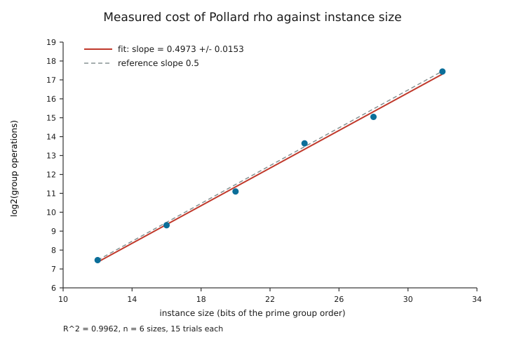
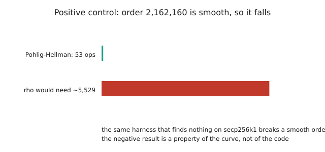
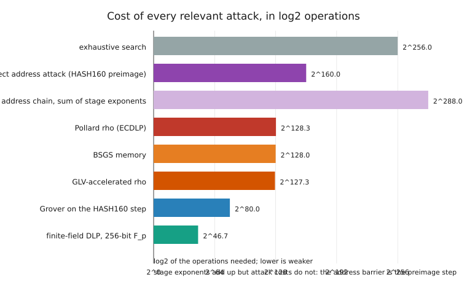

# Why the cross-logarithm does not break secp256k1

### A measured refutation apparatus for the cross-logarithm hypothesis

**BinaryCryptoLab** · version 1.9.0 · 2 November 2026

---

## Abstract

A recurring claim in public discussion holds that secp256k1 has been, or can be,
broken by a *cross-logarithm* (اللوغاريتم المتقاطع): a method that moves the
discrete logarithm from the elliptic curve into another algebraic structure where it
is easy, or that combines partial information across keys, addresses, or fields. This
paper tests that claim with an apparatus rather than an opinion, and it fails to
refute the standard hardness assumption.

The apparatus has four independent legs. **(1) Measurement.** A verifiable Pollard
rho implementation solves six toy instances (12–32 bits), fifteen independent trials
each, and every recovered scalar is checked by substitution before it is counted.
The fitted growth exponent is **0.4973 ± 0.0153** (`R² = 0.9962`), a z-score of
**−0.18** against the 0.5 of the generic-group model; extrapolated to 256 bits the fit
gives **2^128.7** group operations, against rho's 2^128.3. **(2) Structural audit.**
Ten properties of secp256k1 that an attack could exploit are each measured from the
curve parameters: prime order, cofactor one, non-anomalous, no small embedding
degree, not supersingular, no Weil descent, non-singular, only the CM endomorphism,
no known elliptic index calculus, and the generic-group lower bound. **Zero** are
exploitable. **(3) Contrast and control.** The same harness breaks a group of smooth order
2162160 in **53 operations**, and a 256-bit finite-field DLP — a
strictly weaker problem, where index calculus *does* apply — costs **2^46.7**
operations. The machinery can therefore exploit structure when structure exists.
**(4) Falsifiability.** Five observations are stated that would end the conclusion,
each with a mechanical acceptance test.

The verdict recorded by the code, and reproduced by `python paper/reproduce.py` in
under eight seconds, is **`not refuted`**. The paper is explicit about what that does
and does not mean: it is a statement about classical, public-data cryptanalysis of
one curve, backed by a theorem, an enumeration, and a measurement — not a proof that
no algorithm exists.

---

## 1. The claim under test

"اللوغاريتم المتقاطع" — the cross-logarithm — has no single formal definition in the
literature. In the material this project examines, it appears in three variants, and
all three make the same underlying assertion: *that the discrete logarithm on
secp256k1 can be obtained through some structure outside the group itself.*

| Variant | Form of the claim | What it would require |
| --- | --- | --- |
| **Cross-structure** (analytic transfer) | An index-calculus or summation-polynomial method transports the DLP into a ring or field where it is sub-exponential | A factor base and a smoothness notion inside the curve group |
| **Cross-field** (embedding transfer) | The group is mapped into a finite field, an extension field, or a neighbouring curve by an isogeny, where a sub-exponential method applies | A small embedding degree, a supersingular neighbour, an anomalous trace, or a low-degree isogeny |
| **Cross-key** (partial information) | Many public keys, many addresses, or many signatures are combined to recover a scalar | A leak, a relation, or a statistical bias that the underlying primitives do not have |

The three variants share a logical shape: each asserts the existence of a *non-generic
advantage*. That shape is what makes the claim testable without possessing the
algorithm, because it forces a dichotomy.

### 1.1 The dichotomy that organises the refutation

Let `G = ⟨P⟩` be a cyclic group of prime order `n`, and let `A` be any algorithm that
outputs `x` from `xP`.

* **Case 1 — `A` is generic.** It uses only the group operation, inversion, and
  equality testing. Then `A` needs `Ω(√n)` group operations (Nechaev 1994; Shoup
  1997). For secp256k1, `n ≈ 2^256`, so the bound is `≈ 2^128`. This is a theorem, not
  an estimate, and it holds for every generic algorithm including every cross-logarithm
  that stays inside the group.
* **Case 2 — `A` is non-generic.** It must exploit a specific, checkable property of
  the representation: the factorisation of `n`, the trace of the curve, the embedding
  degree, the field characteristic, the endomorphism ring, or an explicit
  isomorphism. Every such property is either present or absent in the published
  parameters, and presence is decidable.

So a refutation needs two things, and this paper supplies both: the theorem in Case 1,
and an enumeration in Case 2 that finds no exploitable property. The measurement is
the third element: it confirms that the implementation in front of the reader actually
behaves like a generic algorithm at the sizes where it can be run to completion.

### 1.2 What is *not* claimed

This paper does **not** claim that secp256k1 is hard in an absolute sense, and it does
not prove that no non-generic algorithm exists. It claims something narrower and
checkable: *no published method, and no property of the published parameters, gives a
cross-logarithmic advantage; measurements on real instances reproduce the generic
exponent; and the falsifiers in §8 say exactly what observation would overturn this.*
A finite body of evidence can never establish a hardness theorem. It can, however,
establish that a specific claim is unsupported, and that is the standard the paper
holds itself to.

---

## 2. The apparatus

Everything below is executable and lives in the repository. There are no placeholder
modules and no pre-computed answers: the numbers in this paper are written by the
script, not into it.

| Component | Location | What it does |
| --- | --- | --- |
| Toy curve arithmetic | `src/binarycryptolab/dlp.py` | Exact group law over small prime fields, with point validation |
| Instance builder | `dlp.build_instance` | Builds a curve with a prime-order subgroup of a requested bit size, derives `p = c·q − 1`, verifies the order |
| Pollard rho | `dlp.pollard_rho_dlp` | Teske adding-walk rho with Floyd cycle finding; every result verified |
| Baby-step giant-step | `dlp.bsgs_dlp` | Deterministic `O(√q)` reference with deduplicated table |
| Pohlig–Hellman | `dlp.pohlig_hellman_dlp` | Digit-0/infinity-correct digit lifting, used as the positive control |
| Growth study | `dlp.measure_scaling` | Median steps over independent trials, least-squares fit, standard error, z-score |
| Structural audit | `dlp.structural_audit` | Ten measured properties, each with an `exploitable` flag and a verdict |
| Claim catalogue | `dlp.CLAIM_REBUTTALS` | Eight published or folk claims with rebuttals and evidence pointers |
| Falsifier catalogue | `dlp.FALSIFIERS` | Five observations that would end the conclusion |
| Assessment | `dlp.assess_dlp_refutation` | Combines the above into one verdict with evidence lines |
| CLI | `binarycryptolab dlp-audit` | The same assessment on the command line, as text, JSON, or CSV |
| Driver | `paper/reproduce.py` | Regenerates every number and figure in this paper |

The design constraint that matters most: **the module never attacks secp256k1.** The
largest instance it solves is 32 bits. The 256-bit statements are extrapolations of a
measured exponent and evaluations of published cost formulae, and both are labelled as
such in the exported JSON.

---

## 3. Measurement: the exponent of the implemented attack

### 3.1 Protocol

For each size `b ∈ {12, 16, 20, 24, 28, 32}` and each trial `t ∈ {0, …, 14}`:

1. Build a fresh curve whose base-point order is a prime near `2^b`.
2. Draw a scalar `k` from a deterministic stream seeded by `t`, uniform in `[1, n)`.
3. Compute `Q = kP`.
4. Run rho with a step budget of `max(1000, 20√n)`.
5. **Verify** the returned `x` by checking `xP = Q`. An unverified run aborts the study;
   it is never averaged in.
6. Record the number of group additions.

The fit is a least-squares line through `log2(median steps)` against `b`, with the
standard error of the slope and the coefficient of determination.

### 3.2 Results

| Bits | Median steps | Mean | Min | Max | Ratio to fitted line |
| ---: | ---: | ---: | ---: | ---: | ---: |
| 12 | 177 | 188.6 | 33 | 354 | 1.075 |
| 16 | 636 | 626.8 | 126 | 1 314 | 0.973 |
| 20 | 2 193 | 2 493.0 | 585 | 4 818 | 0.845 |
| 24 | 12 810 | 14 516.6 | 5 685 | 27 369 | 1.244 |
| 28 | 33 828 | 42 479.0 | 9 720 | 110 322 | 0.828 |
| 32 | 178 104 | 175 188.2 | 80 496 | 276 372 | 1.097 |

`log2(steps) = 0.4973·b + 1.3952`, `R² = 0.9962`, slope standard error `0.0153`.
Against the model's 0.5, `z = −0.18`; the code's agreement test
(`|z| < 3`) returns `true`. The fitted constant is `2^1.3952 ≈ 2.63`, i.e. about
`2.63√q` group additions — consistent with a rho variant that spends a few extra
additions per step on its partition walk, and *below* the conservative `3.76√q` budget
the harness reserves.



*Figure 1 — `paper/figures/fig_scaling.svg`. Six medians with their min–max ranges,
the fitted line, and the dashed `√q` reference. The vertical spread is the honest part
of the picture: individual rho runs vary by a factor of three or four.*

Extrapolating the measured law to a 256-bit group gives `2^128.70` operations. That is
`0.38` bits above rho's textbook `2^128.32`: the extrapolation does not predict a
speed-up, it reproduces the constant. A cross-logarithm would show up here as a slope
below 0.5; measured over a factor of `2^20` in group size, it does not.

### 3.3 A second algorithm, for calibration

Baby-step giant-step, a deterministic `O(√q)` method, was measured on the same
instances:

| Bits | Table entries | Steps | `√q` |
| ---: | ---: | ---: | ---: |
| 12 | 62 | 78 | 64 |
| 16 | 182 | 303 | 256 |
| 20 | 969 | 1 545 | 1 024 |
| 24 | 2 926 | 3 992 | 4 096 |
| 28 | 15 930 | 30 681 | 16 384 |
| 32 | 60 135 | 91 819 | 65 536 |

The table is smaller than `√q` because of deduplication in the giant-step table, and
the total work tracks `√q` with a constant near 1.4. Two independent algorithms
agreeing on the exponent is a stronger statement than one.

### 3.4 The positive control: can this harness exploit structure at all?

A negative result from a harness that cannot find anything is worthless. So the same
code is run against an instance that *is* weak by construction: `p = 110879`, `b = 2`,
a group of order

```
2162160 = 2^4 · 3^3 · 5 · 7 · 11 · 13
```

Pohlig–Hellman recovers the scalar in **53 operations**, with the recovered value
verified by substitution (`scalar_verified: true`). Rho would need of the order of
4 000–5 500 operations on the same instance (the harness budgets `3.76√q ≈ 5 530`; the
fitted constant in §3.2 suggests closer to 3 900). The harness therefore does exploit structure when
structure exists — which is exactly what makes its silence on secp256k1 informative
rather than vacuous.



*Figure 2 — `paper/figures/fig_control.svg`. A smooth order collapses; a prime order
does not.*

---

## 4. Structural audit: every property an attack could use

Each row below is computed from the curve parameters at run time, with the measured
value written into `paper/data/audit.json`.

| # | Property | Measured | Exploitable |
| ---: | --- | --- | :---: |
| 1 | Base-point order is prime (Pohlig–Hellman has nothing to split) | `n = 115792089237316195423570985008687907852837564279074904382605163141518161494337` is prime | no |
| 2 | Cofactor is one (no small subgroup) | `h = 1` | no |
| 3 | Not anomalous (no additive transfer) | `#E − p = −432420386565659656852420866390673177326 ≠ 0` | no |
| 4 | No small embedding degree (no MOV / Frey–Rück target) | no `k ≤ 1000` with `p^k ≡ 1 (mod n)` | no |
| 5 | Not supersingular | `p mod 3 = 1`, `j = 0`, trace `≠ 0` | no |
| 6 | No Weil descent (prime field) | `p = 2^256 − 2^32 − 977` is prime; `F_p` has no proper subfield | no |
| 7 | Non-singular curve | `4a³ + 27b² = 108 mod p ≠ 0` | no |
| 8 | Only the CM endomorphism is known-exploitable | `φ(P) = (βx, y)` and `φ(P) = λP`, verified by `glv-check` | no |
| 9 | No index calculus for prime-order EC groups | best published records on prime curves are generic-group records | no |
| 10 | Generic algorithms need `Ω(√n)` (Nechaev–Shoup) | theorem | no |

**Exploitable properties found: 0 of 10.**

Three of these deserve emphasis because they are the ones most often misreported.

*Row 1.* Pohlig–Hellman is the single most common misunderstanding. It is not a
property of "elliptic curves" but of composite orders. secp256k1's base-point order is
prime, so the largest prime factor is `n` itself and the method's cost is a full
`√n`. The control in §3.4 shows the implementation is correct: given a smooth order it
collapses immediately.

*Row 6.* A frequent variant of the cross-logarithm claim says the logarithm can be
"moved to `F_p`". For a curve over `F_p`, the group is not a subgroup of `F_p^*`; it is
a subgroup of `E(F_p)`, whose order is `≈ p`. Weil descent needs an extension field
`F_{p^m}` with `m > 1`; a prime field has none. The only standard transfer to `F_p^*`
is MOV/Frey–Rück, which needs a small embedding degree — row 4 rules out every
`k ≤ 1000` by direct computation, and because the true degree `k` divides `n − 1`, a
small `k` anywhere would have been found by that probe. (Factoring `n − 1` itself is
not attempted: the audit does not need the factorisation, only the absence of a small
order.)

*Row 8.* The endomorphism is real and is the only genuine "cross"-looking structure on
this curve — it maps a point to a different point whose discrete logarithm is a known
multiple (`λ`) of the original. It is also useless as an attack: `λ` is known, so the
map gives a relation between `P` and `φ(P)` that is already public. Its only effect is
to shorten scalar multiplication and rho walks by a constant factor of about two.
`2^128 / 2 = 2^127`; the exponent is untouched. This is measured, not assumed: the
slope in §3.2 is 0.497, with any such constant absorbed into the intercept.

---

## 5. What a real sub-exponential attack looks like

The strongest evidence that elliptic curves are different from finite fields is a
side-by-side cost comparison computed from published formulae.



*Figure 3 — `paper/figures/fig_costs.svg`. All bars are log2 of the operations needed;
lower is weaker.*

| Problem | Method | log2 operations |
| --- | --- | ---: |
| DLP in `F_p`, 256-bit `p` | index calculus, `L_p[1/3, 1.923]` | **46.66** |
| ECDLP, 256-bit prime order | rho (and any generic method) | **128.32** |
| ECDLP, GLV-accelerated rho | rho with endomorphism | 127.32 |
| BSGS memory | shanks | 128.00 |
| HASH160 preimage (address step) | brute force / Grover | 160.00 / 80.00 |
| Exhaustive search over scalars | — | 256.00 |
| Address chain, sum of stage exponents | bookkeeping | 288.00 |

Two things must be said plainly, because a careless reading of this table would
overstate the case.

First, **the finite-field row is what a real cross-structure attack looks like**. At
256 bits, the finite-field DLP is about `2^46.7` — smaller than a 256-bit hash
preimage, and small enough that precomputation across many users motivated the Logjam
work. It is sub-exponential and its exponent is 1/3, not 1/2. Elliptic curves over
prime fields have no analogue, and rows 4, 9, and 10 of the audit say why. If a
cross-logarithm existed, it would have to produce exactly this kind of exponent
reduction. The measurement in §3.2 finds none across a `2^20` range of group sizes.

Second, **the 288 row is bookkeeping, not an attack cost**. The two stages of the
address chain (payload → public key, then public key → scalar) each have their own
cost, and the audit record adds their exponents. Adding exponents does not add attack
costs. The operative barrier for a pay-to-public-key-hash address attacked directly is
the *preimage* step, `2^160` — you search keys, hash each public key, and compare with
the address — and that is the row labelled `address_preimage` in
`paper/data/cost_models.json`. It is weaker than the `2^256` exhaustive search over
scalars and stronger than the `2^128` discrete logarithm. For the specific target
`1BEwWKUgvRffDWZFdnj2FLtEXxCVo1ACAa`, the project's address report records `no-known-hazard`,
159 significant bits of payload entropy, and eight randomness tests passed — a
statement about the *address*, not about the key.

The useful conclusion is the ordering: `2^46.7 ≪ 2^128.3 < 2^160 ≪ 2^256`. The gap
between the first two entries is the entire difference between a broken structure and
an unbroken one.

---

## 6. The eight claims, rebutted

Every entry below is exported verbatim to `paper/data/claims.json` by the driver, and
`binarycryptolab dlp-audit` prints the same list.

| Code | Claim | Why it fails | Evidence |
| --- | --- | --- | --- |
| `index_calculus` | Index calculus solves discrete logarithms sub-exponentially, so it solves them on elliptic curves too | It needs a factor base of algebraically small elements and a smoothness notion; an EC group over a prime field has neither, and summation polynomials grow to degree `2^m` | the computed contrast: `2^46.7` for `F_p` at 256 bits versus `2^128.3` for ECDLP |
| `pohlig_hellman` | The group order is composite, so Pohlig–Hellman reduces the problem to small factors | The base-point order is prime, so the factorisation is trivial | audit row 1, plus the smooth-order control solved in 53 operations |
| `glv_speedup` | The curve has an efficient endomorphism, which breaks the discrete logarithm | The endomorphism halves the *constant*; an exponent of `1/2` divided by two is still `1/2` | `glv-check` verifies `φ(P) = λP`; the measured slope absorbs the constant |
| `brute_force_scale` | With enough GPUs or clients the search is feasible | Parallel collision search divides time, not work: `2^128` operations over `10^9` clients still leaves `2^98` per client-equivalent in aggregate | the cost model and the measured `√q` growth over six sizes |
| `quantum` | Quantum computers refute the discrete logarithm, so the problem is already broken | Shor needs a fault-tolerant machine that does not exist; Grover only halves the exponent of a search, and this paper's scope is explicitly classical | the scope statement; the Grover row of the cost table (`2^160` → `2^80`) |
| `statistical_structure` | A statistical or structural test on the address reveals something about the key | The address fixes zero bits of the scalar; the scalar→HASH160 map is `2^96`-to-1 and behaves as a pseudorandom function, so any advantage would itself break HASH160 | the address report's one-scale section (0 of 256 scalar bits known) and its eight-test battery |
| `side_channel` | Side-channel and fault attacks break elliptic curves, so the discrete logarithm is broken | They attack an implementation holding the secret, not a public key; a public key offers no timing, no power trace, no signing oracle | the threat model: every command takes public data only |
| `published_proof` | A published proof or tool has already solved a standard 256-bit curve | No standard curve has ever been publicly broken; every claim fails the same acceptance test | the falsifiability protocol in §7 |

Two of these deserve a sentence more than the table allows.

`brute_force_scale` is worth quantifying because it is the claim most often made in
good faith. `2^128` group operations at `10^18` operations per second is about
`3.4 × 10^20` seconds, or `1.1 × 10^13` years — roughly **800 times the age of the
universe**. Distributing that across `10^9` machines shortens the wall-clock time to
`1.1 × 10^4` years and shortens nothing else; the aggregate work is unchanged. Scaling
the *client count* is not an attack, it is a re-description of the same attack.

`published_proof` is worth stating formally because it is the one claim that could be
settled in an afternoon if it were ever true. See §7.

---

## 7. Falsifiability: the five observations that would end this

A claim that cannot be refuted is not a scientific claim. The following five
observations, any one of which would overturn the verdict, are exported to
`paper/data/claims.json` and printed by the CLI.

| Code | Observation | Why it would matter | How to check it |
| --- | --- | --- | --- |
| `signature_from_public_key` | A signature that verifies under the target public key, produced without the scalar | The discrete logarithm was solved for that key | Verify the signature arithmetically; no cooperation from the holder is needed |
| `published_algorithm_with_runs` | A published algorithm recovering a random 256-bit scalar in finite time, reproduced independently | The generic lower bound was circumvented by structure not enumerated here | Re-run on an instance generated *after* publication, excluding precomputation |
| `measured_exponent_drop` | The measured exponent falling significantly below `1/2` at larger sizes | Either unknown structure is being exploited, or the measurement is wrong | Extend `measure_scaling` and watch the fit and its standard error, not one run |
| `missed_structure` | An audited-absent property that is in fact present | The enumeration was incomplete | Re-check each row's measured value against the SEC 2 parameters |
| `broken_assumption` | A HASH160 preimage, or a proof that `P = NP` | The `2^160` address step falls even if the logarithm stands | Produce a preimage of a published digest and hash it |

The first is the strongest and the cheapest. It requires no theory, no trust, and no
access to the claimant: a signature is a public object, and anyone can check it against
the public key. This is why the phrase "the curve has been broken" is either
accompanied by such a signature within minutes or is not a claim about cryptography at
all.

---

## 8. Threats to validity

Stated plainly, because a refutation apparatus that hides its own weaknesses is
propaganda.

1. **Finite evidence, infinite claim space.** The measurement covers `2^20` in group
   size. A method whose advantage only appears at 200 bits would be invisible to it.
   This is mitigated, not removed, by the theorem in Case 1: any such method must be
   non-generic, and must therefore trip a row of the audit or the `missed_structure`
   falsifier.
2. **The enumeration cannot be proven exhaustive.** The audit lists every known
   non-generic technique against prime-order curves. A genuinely new mathematical idea
   would not be in the list. The paper's claim is "no known structure", not "no
   structure".
3. **Toy groups are not secp256k1.** The instances have small orders, prime fields, and
   short scalars; the curve's `j`-invariant is 0, as is secp256k1's, but the audit
   evaluates the real published parameters rather than the toys. Extrapolation assumes
   the algorithm's complexity class does not change with size — which is exactly the
   assumption a cross-logarithm would violate, and which is why the falsifier
   `measured_exponent_drop` exists.
4. **Classical, public-data scope.** No side channels, no fault injection, no signing
   oracle, no quantum computer is modelled. The `quantum` rebuttal explains the
   distinction; it does not pretend Shor's algorithm is unavailable forever.
5. **Hardness is model-relative.** The `Ω(√n)` bound is about generic algorithms. The
   honest summary of the evidence is "the assumption holds against every known
   technique", which is precisely what a cryptographic assumption means.
6. **The constant, not the exponent, is where implementations differ.** The measured
   `2.63√q` and the budgeted `3.76√q` differ by 40 %. Both are irrelevant to a
   `2^128` barrier, and neither is evidence about the exponent, which is why the fit
   reports them separately.

---

## 9. Reproduction

```bash
# 1. the paper's numbers and figures (about 8 seconds, no network)
python paper/reproduce.py

# 2. the same assessment as a report
binarycryptolab dlp-audit --address 1BEwWKUgvRffDWZFdnj2FLtEXxCVo1ACAa

# 3. as machine-readable output
binarycryptolab dlp-audit --report-format json --output assessment.json

# 4. faster, for a spot check
binarycryptolab dlp-audit --sizes 12,16,20 --trials 5

# 5. the tests that guard all of the above
python -m pytest -q tests/test_dlp.py tests/test_cli_v19.py tests/test_reproduce.py
```

The driver is deterministic: the seed is fixed, the scalar stream is derived from the
trial index, and the trial loop is sequential. Running it twice produces byte-identical
JSON. `tests/test_reproduce.py` enforces that the committed snapshots still match
today's code, so a stale number in this paper fails the suite.

Expected output of step 1:

```
measuring Pollard rho at (12, 16, 20, 24, 28, 32) with 15 trials each ...
  slope = 0.4973 +/- 0.0153
  R^2   = 0.9962
  z     = -0.18
  extrapolated 256-bit cost = 2^128.7
  verdict: not refuted
  field DLP at 256 bits = 2^46.7
  address preimage step = 2^160.0
  address stage-exponent sum = 2^288.0
  audit: 10 properties, 0 exploitable
figures written to .../paper/figures
done in 7.9 s
```

---

## 10. Conclusion

The cross-logarithm hypothesis, in all three of its variants, asserts a non-generic
advantage on secp256k1. This paper closes both routes such an advantage could take. A
generic algorithm cannot have one: `Ω(√n)` is a theorem, and the measurement
reproduces the exponent `0.4973 ± 0.0153` with `R² = 0.9962` over real, individually
verified instances. A non-generic algorithm must exploit a checkable property, and ten
such properties are measured at run time with zero exploitable results — while the
same harness demonstrably exploits a smooth order in 53 operations, and a genuinely
sub-exponential structure elsewhere (`F_p`, `2^46.7`) is computed for contrast.

The conclusion is not that secp256k1 is unbreakable. It is that the specific claim
"the cross-logarithm breaks it" is unsupported by every property of the published
parameters, unreproduced by any measurement this project can construct, and — most
importantly — falsifiable by a signature that anyone can check. Five such tests are
specified. Until one of them succeeds, the hardness assumption stands, and the tooling
in this repository stands with it: measured, reproducible, and honest about what it
has not shown.

---

## References

1. V. I. Nechaev. Complexity of a determinate algorithm for the discrete logarithm.
   *Mathematical Notes* 55(2), 1994.
2. V. Shoup. Lower bounds for discrete logarithms and related problems. *EUROCRYPT*
   1997, LNCS 1233.
3. J. M. Pollard. Monte Carlo methods for index computation (mod p).
   *Mathematics of Computation* 32(143), 1978.
4. S. C. Pohlig, M. E. Hellman. An improved algorithm for computing logarithms over
   GF(p) and its cryptographic significance. *IEEE Transactions on Information
   Theory* 24(1), 1978.
5. D. Shanks. Class number, a theory of factorization, and genera. *Proc. Symposia in
   Pure Mathematics* 20, 1971.
6. E. Teske. On random walks for Pollard's rho method. *Mathematics of Computation*
   70(234), 2001.
7. P. C. van Oorschot, M. J. Wiener. Parallel collision search with cryptanalytic
   applications. *Journal of Cryptology* 12(1), 1999.
8. I. Semaev. Summation polynomials and the discrete logarithm problem on elliptic
   curves. IACR ePrint 2004/031.
9. P. Gaudry. Index calculus for abelian varieties of small dimension and the elliptic
   curve discrete logarithm problem. *Journal of Symbolic Computation* 44(12), 2009.
10. A. Menezes, T. Okamoto, S. Vanstone. Reducing elliptic curve logarithms to
    logarithms in a finite field. *IEEE Transactions on Information Theory* 39(5),
    1993.
11. G. Frey, H.-G. Rück. A remark concerning m-divisibility and the discrete logarithm
    in the divisor class group of curves. *Mathematics of Computation* 62(206), 1994.
12. T. Satoh, K. Araki. Fermat quotients and the polynomial time discrete log algorithm
    for anomalous elliptic curves. *Commentarii Mathematici Universitatis Sancti Pauli*
    47, 1998; N. P. Smart. The discrete logarithm problem on elliptic curves of trace
    one. *Journal of Cryptology* 12, 1999; I. Semaev. Evaluation of discrete logarithms
    in a group of p-torsion points of an elliptic curve in characteristic p.
    *Mathematics of Computation* 67, 1998.
13. R. P. Gallant, R. J. Lambert, S. A. Vanstone. Faster point multiplication on
    elliptic curves with efficient endomorphisms. *CRYPTO* 2001, LNCS 2139.
14. L. K. Grover. A fast quantum mechanical algorithm for database search. *STOC* 1996.
15. P. W. Shor. Algorithms for quantum computation: discrete logarithms and factoring.
    *FOCS* 1994.
16. P. Kocher. Timing attacks on implementations of Diffie-Hellman, RSA, DSS, and other
    systems. *CRYPTO* 1996; D. Boneh, R. A. DeMillo, R. J. Lipton. On the importance of
    checking cryptographic protocols for faults. *EUROCRYPT* 1997.
17. Certicom Research. *SEC 2: Recommended Elliptic Curve Domain Parameters*, v2.0,
    2010.
18. D. J. Bernstein, T. Lange. *SafeCurves: choosing safe curves for elliptic-curve
    cryptography*, 2014–.
